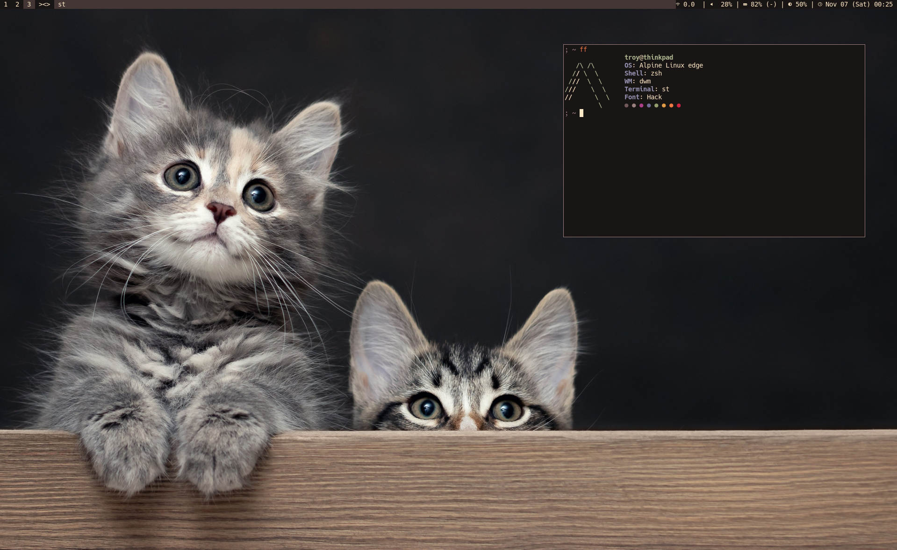

# My Setup

First published: 2026/10/29

Here I document my PC setups that nobody cares about.

## Laptops

### Lenovo Thinkpad T14 Gen 3 (2026-present)

Bought used. I love it a lot. I got it both for my studies and to run 9front, because I wanted a smaller and lightweight laptop to carry to university. It is my dailydriver at the moment. I use it to read and write documents, write code, and to analyse corpora.

#### Specs

- __CPU__: 12th Gen Intel Core i5-1245U (4+8) @ 4.40 GHz
- __GPU__: Intel UHD Graphics @ 1.20 GHz
- __RAM__: 16 GB
- __Storage__: 500 GB SSD
- __Display__: 1920x1200 14"
- __Battery__: 51.5 Wh by design, but it has seen some use when I got it

#### Software

- __OS__: Alpine Linux (edge) / 9front
- __WM__: dwm
- __Terminal__: st
- __Shell__: sh / zsh
- __Editor__: vim
- __Browser__: qutebrowser
- __Music player__: cmus

#### Screenshot

### MSI Sword 15 A11UD (2022-present)

Probably the worst purchase I've made. Due to my inexperience, I thought gaming laptops were a "good deal". I wanted something with a better GPU, expecting myself to get into a lot of graphics work. But I also wanted to game on it. Overall, I'm satisfied with it and I use it for running heavy music production software, but that fan noise when gaming (even lighter games!) is troubling. I only have fan noise issues on Windows, because my Linux setup does not even use the GPU. Additionally, Windows has a CPU usage spike at startup. I recently got the motherboard replaced. I will have to investigate dust, fans, and thermal paste issues... later, because I'm just using my Thinkpad for now (busy!).

#### Specs

- __CPU__: 11th Gen Intel Core i7-11700K (8) @ 3.60 Ghz
- __GPU__: Nvidia RTX 3050Ti / Intel UHD Graphics 750
- __RAM__: 16 GB
- __Storage__: 1 TB HDD, 500 GB SSD
- __Display__: 1920x1080 15.6"
- __Battery__: I don't know. It's plugged in all the time because it drains too quickly. 

#### Software

- __OS__: Windows 10 / Void Linux (glibc)
- __WM__: dwm
- __Terminal__: st
- __Shell__: zsh
- __Editor__: vim
- __Browser__: Librewolf / qutebrowser
- __Music player__: Strawberry / foobar2000

### Dell Inspiron 15-3567 (2018-retired 2026)

My first personal laptop. The old faithful. It was a journey we had. For a Dell Inspiron, it actually lasted quite long before it got bad. When my Sword had an issue (because of course it did), I used this Inspiron in the meantime, which was around 2 years, I think, until the Sword was repaired. I currently use it as a homeserver, and it does its job well. However, the HDD is getting old and needs a replacement. It has a problem with its power source detection circuit as well, and the plastic was falling apart in a lot of places when I opened it up to replace the AC port.

#### Specs

- __CPU__: 7th Gen Intel Core i7-7500U (4) @ 2.70 GHz
- __GPU__: AMD Radeon R4 / Intel HD Graphics 620
- __RAM__: 8 GB
- __Storage__: 1 TB HDD
- __Display__: 1366x768 15.6"
- __Battery__: 40 Wh

#### Software

- __OS__: Artix Linux (runit), formerly Void Linux (musl)
- __WM__: i3
- __Terminal__: st
- __Shell__: zsh
- __Editor__: VSCodium
- __Browser__: links / w3m / Librewolf
- __Music player__: cmus

## Servers

### VPS (2025-present)

It's a bit of an overkill but it was cheap, at least until the RAM prices went up... OVHCloud is actually still cheaper than other hosting providers, though. I was expecting to host Wordpress on it for somebody, which would eat up RAM, but I haven't done it yet, after all.

#### Specs

- __CPU__: 4 virtual cores
- __RAM__: 8 GB
- __Storage__: 75 GB
- __OS__: FreeBSD

#### Hosted Services

Those marked with an asterisk are set up but inactive at the moment.

##### Softmachine.dev

- Nginx
- Werc
- Cgit
- \*Icecast (radio, wip)
- \*Owncast
- Tor
- I2P
- Proxied services (see #Inspiron)

##### Bir.ee (tilde)

- Nginx (static hosting for users)
- Gemini via Agate
- \*Luanti server
- \*Modded Minecraft beta server
- Matrix (Continuwuity)
- \*Etherpad
- Silverbullet.md
- bin (simple pastebin)
- \*Uguu
- \*Discord bots (wip)

### Aforementioned Inspiron (2024-present?)

#### Hosted Services

- Jellyfin (movies, TV series, music, manga)
- Calibre (book library)
- PartDB (electronic component stock database)
- Stoat (failed experiment)

All of these services are proxied via my VPS to allow access on the go, but they are not open to the public (unless you're my friend).

I also host files shared via Soulseek and torrent, which were up  24/7 for quite long until recently. I am not sure which one of my laptops hosts a larger music library by now. They were mirrored at some point, but not anymore.
